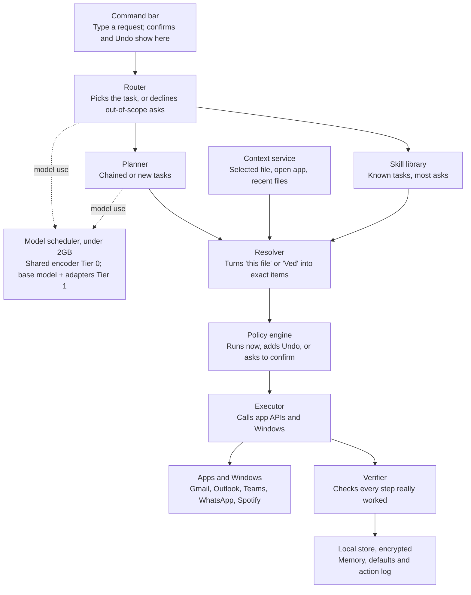

# Local Assistant Engine — 06 High-Level Design

**6 Nov 2026** · **@Ved Narvekar**

## Summary

The engine is a light desktop app that runs every request on the laptop, using small models plus plain code. This is a first draft. It gets revised once the spikes in 05 return real numbers.

## Design principles

1. **Code does most of the work.** Models only answer narrow questions, like “which task?” or “which contact?”
2. **Known tasks skip the big model.** Ready-made skills cover most requests.
3. **Load models only when needed.** One shared base with small swappable adapters keeps memory low.
4. **Official APIs first.** The accessibility tree is the fallback. No screenshots in V1.
5. **Check every step.** Code confirms each action actually worked.
6. **Safety by risk level.** Anything that sends or shares needs a confirm.

## Architecture

*Known tasks skip the big model, and everything runs on the laptop.*

Most requests flow straight down the left side. The skill library handles known tasks, so the 1–3B base model loads only for chained or new ones.

## Components

| Component | What it does | Tech | Memory |
|---|---|---|---|
| Command bar | Takes typed requests, shows confirms, results and Undo | Tauri (uses the OS web view) | ~40MB |
| Core engine | Runs the whole flow and the background service | Rust | ~30MB |
| Router | Picks the task, or “out of scope” | Small encoder + classifier head (ONNX Runtime) | Shared ~150MB |
| Extractor | Pulls out names, files, times, places | Same encoder, extraction head | Shared |
| Resolver | Turns “this file” or “Ved” into the exact item | Rust code + context service + memory | Small |
| Skill library | Ready-made workflows for the 49 tasks | Declarative skill files (YAML) | Small |
| Planner | Builds plans for chained or new requests | 1–3B model, 4-bit, with adapters (llama.cpp) | ~1–1.8GB, on demand |
| Policy engine | Applies risk levels, confirms and blocks | Rust code | Small |
| Executor | Calls apps and the OS | Connectors: Google APIs, Microsoft Graph, Windows APIs, UI Automation | Small |
| Verifier | Checks each step really worked | Rust code, per-skill checks | Small |
| Context service | Knows the selected file, open app and recent files | Windows UI Automation + file system | Small |
| Model scheduler | Loads and unloads models within the 2GB budget | Rust, memory-mapped model files | Small |
| Local store | Memory, settings, action log, reminders | SQLite with encryption (SQLCipher) | Small |

Idle total stays near 250MB, under the 300MB target. Peak stays under 2GB when the planner loads.

## Request flow

Every request follows the same eight steps. Known tasks never load the planner.

1. **Capture.** The user types in the command bar. The context service attaches the selected file and open app.
2. **Route.** The router picks a task with a confidence score. Out-of-scope requests are declined here.
3. **Plan.** A known task loads its skill template. A chained or low-confidence request loads the planner, which sees only the 3–5 most relevant skills.
4. **Resolve.** The extractor pulls out names, files and times. The resolver matches them to exact items. If two match, the engine asks one question.
5. **Policy check.** The risk level decides: run now, run with Undo, or confirm first.
6. **Execute.** The connector calls the app or the OS.
7. **Verify.** Code checks the result. On failure it retries once, then explains what went wrong.
8. **Report and learn.** One-line result, Undo if needed, an entry in the action log, and updated defaults.

## Model layout

Two tiers. Tier 0 is always loaded and handles most requests. Tier 1 loads only when needed.

| Tier | Model | Jobs | When loaded | Size |
|---:|---|---|---|---|
| 0 | Small shared encoder (~30–100M) | Router, skill retrieval, extraction, email urgency | Always | ~150MB |
| 1 | One 1–3B base model, 4-bit | Planner, summaries, reply drafts | On demand, unloaded after idle time | ~1–1.8GB |
| 1 adapters | Adapters on the base model (~10–50MB each) | One per job: planner, summarizer, reply writer | Swapped in with the job | Small |

All models are trained offline. A large teacher model creates training data. Only the small students ship. Exact model choices come from spikes SP1–SP4.

## Data storage

Everything lives on the laptop. Nothing personal goes to the update server.

| Data | Where | Protection |
|---|---|---|
| Learned defaults (usual contact, app, folder) | Local store | Encrypted; user can view, edit, delete |
| Action log | Local store | Encrypted; user can view and clear |
| Reminders and timers | Local store | Encrypted |
| App sign-in tokens | Windows Credential Manager | Managed by the OS; never in plain text |
| Models and skills | App folder | Signed; checked before loading |
| Settings | Local store | Encrypted |

## Security design

- **Content is never a command.** Email bodies, messages, files and web pages go into the models as marked data. Only the user's own request can start an action. (SR5)
- **The policy engine is plain code.** No model can skip a confirm or a block. (SR4, SR6)
- **Models run in a separate process.** A model crash or memory spike can't take down the engine.
- **Least access.** Each connector asks only for the app permissions its tasks need.
- **Signed updates.** Models and skills are signed. Unsigned files are refused.
- **Web lookups are scrubbed.** Only search terms leave the device, never names or file contents. (PS3)

## Cross-platform approach

The code splits into two layers, so Mac support later means a new adapter, not a rewrite.

- **Shared core (about 80% of the code):** router, planner, skills, policy, verifier, scheduler, store, and the cloud app connectors (Google, Microsoft). This works the same on Windows and Mac.
- **OS adapter (about 20%):** UI Automation, file search, system controls, notifications and the keychain. Windows gets one adapter in V1. Mac gets its own later, using macOS Accessibility and Spotlight.

The split percentages are rough estimates, to be confirmed in the LLD.

## Update server

V1 needs only a small backend. It never receives requests, files or personal data.

- **Model and skill updates:** signed packages the app downloads. Adapters ship as small files, so most updates are a few MB.
- **App updates:** the installer and new versions.
- **Licensing:** checks a free or paid plan, using an account ID only.
- **Crash reports:** opt-in, with personal data stripped.

Federated learning and a team admin console come in later versions.

## Open decisions

- [ ] Revise this draft with the spike results from 05.
- [ ] Pick the exact encoder and 1–3B base model (SP1–SP4).
- [ ] Confirm Tauri works well with the command bar and hotkey on Windows.
- [ ] Choose where the update server is hosted.

**Next doc:** 07 Low-Level Design (LLD). Detailed design per component: skill file format, connector interfaces, scheduler logic, database tables and error handling.
