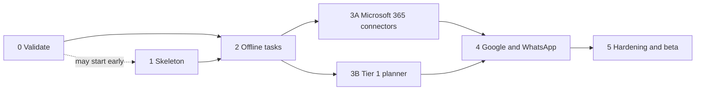

# Local Assistant Engine — 08 Development Phases

**6 Nov 2026** · **@Ved Narvekar**

## Summary

Build in six phases, riskiest ideas first. Phase 0 confirms the design with the spikes in 05 and clears the must-do items in 00. Phase 1 builds a thin skeleton that runs one task end to end. Phases 2–4 add tasks in order of risk: offline tasks, then one work suite with the planner, then the second suite and WhatsApp. Phase 5 hardens the engine and ships a small beta.

Every phase ends on named tests from 04, run on the 8GB laptop. Phases 1–5 get dates after Phase 0, because spike results can change the scope. The only fixed numbers so far are about 5 weeks for the spikes (05) and about 7 months for the whole build (00).

## Phases at a glance

| Phase | Goal | Done when |
|---|---|---|
| 0. Validate | Confirm the design and clear the must-do items | Every spike has a verdict; HLD and LLD revised; no open decision blocks Phase 1 or 2 |
| 1. Skeleton | One task runs end to end | T01 passes; confirm and cancel work; CI is green on Windows |
| 2. Offline tasks | Every task that needs no sign-in, with the real router | 48 tests pass |
| 3. Work suite and planner | Microsoft 365 and the 1–3B planner, in two parallel tracks | 38 more tests pass |
| 4. Google and WhatsApp | The rest of the 49 tasks | The last 14 tests pass, and the Phase 3 tests pass on Google |
| 5. Hardening and beta | Hit every target, then ship to a small beta | All 04 metrics hit on the 8GB laptop |

## Why this order

- **Riskiest first.** WhatsApp, Spotify, Do Not Disturb, model accuracy and memory could each change the design. Phase 0 tests them before anything is built on them.
- **Safety before reach.** The policy engine, confirms and Undo exist in Phase 1, before any connector can send anything.
- **Offline before sign-in.** Offline tasks exercise the whole pipeline with no OAuth, legal or account risk.
- **Big model late.** Known tasks skip the 1–3B model (06), so it comes after Tier 0 works.
- **WhatsApp last.** It carries the most legal and UI-fragility risk, and V1 has a fallback if it fails (SP5).

## Working rules

- A phase is done when its listed tests pass on the 8GB laptop.
- A skill is done when its YAML passes validation, its 04 tests pass, its failures end in a one-line message (07), and its Undo is defined or marked `none`.

## Phase 0 — Validate

**Depends on:** docs 00–07 drafted.

**Goal:** Turn the draft HLD and LLD into a confirmed design, and finish what 00 says must happen before coding.

**Work**

- **Decision log.** Gather every open decision from docs 1–7 (over 20) into one list. Close the ones that block Phases 1–2 first: the first suite, the alpha tasks, the WhatsApp fallback, the encoder and 1–3B picks, the UI framework and the update server host. Settle two conflicts between docs:
  - 01 targets Microsoft 365 office workers with 20–30 tasks. 02 has 49 tasks, both suites and personal users.
  - 06 and 07 use one shared encoder with router and extractor heads. 6.1 uses a separate embedding model and a GLiNER-class extractor.
- **Spikes.** Run SP1–SP10 in the order in 05, on the 8GB laptop. Add SP11 below.
- **Interviews.** Talk to 10–20 target users: do they want it, which tasks matter, would they pay.
- **Legal and platform.** Start Google API verification (it can take weeks) and Microsoft app registration now. Read the WhatsApp, Spotify and YouTube terms. Book the lawyer review.
- **Licenses.** Check the license and upkeep of every crate before Phase 1, and the terms of every model family before SP1–SP4 (6.1).
- **UX flows.** Design onboarding, app sign-in, permissions, confirm screens and error messages, one phase ahead of the code that needs them (00).
- **Environment.** A native Windows dev machine with the Rust MSVC toolchain and Tauri prerequisites, the 8GB test laptop, and the test accounts from 04. Windows-only code can't be built or tested in WSL.
- **Budget.** Put a number on about 7 months of a 6–8 person team, plus GPUs, cloud, code signing and legal (00).

**New spike (proposed addition to 05)**

| ID | Risk being tested | Pass if | If it fails |
|---|---|---|---|
| SP11 | Does the Tauri command bar fit the memory budget and open fast from a hotkey? | Idle memory with the bar hidden fits the ~40MB share in 06, and the hotkey opens the bar from any app | Close the web view when hidden and reopen it on the hotkey, or rebalance the 300MB idle budget |

WebView2 can use more than the ~40MB that 06 budgets for the command bar, and SP8 only reaches the shell in week 5. SP11 checks it early.

**Done when:** every spike is a pass or has an agreed fallback. HLD and LLD are revised with the real numbers. No open decision blocks Phase 1 or 2. The WhatsApp, Spotify and YouTube terms have a recorded answer. The interviews are summarized. A go or no-go is written down.

## Phase 1 — Skeleton

**Depends on:** the repo layout, UI framework and Windows environment from Phase 0. It can start while the spikes run, except the command bar, which waits for SP11.

**Goal:** One request flows through the whole pipeline with the simplest possible parts.

**Work**

- **Cargo workspace.** Keep Windows APIs in one crate, so the rest builds and tests on WSL as well as Windows. Proposed layout (confirm in the LLD):
  - `crates/core`: flow, resolver, policy, verifier, scheduler
  - `crates/skills`: YAML loader and validator
  - `crates/connectors`: the Connector trait and the cloud connectors
  - `crates/adapter-windows`: UI Automation, named pipes, Credential Manager, system controls
  - `crates/model-worker`: the separate model process
  - `crates/store`: SQLCipher tables and migrations
  - `crates/ipc`: message types shared by UI, Core and worker
  - `crates/testset-runner`: runs the 100 tests
  - `app/` for Tauri and the UI, `skills/` for the YAML files, `spikes/` for throwaway code, `server/` for later
- **Processes.** Core service and UI process, talking over named-pipe JSON (07).
- **Command bar.** Global hotkey, text input, confirm, choices, Undo and a one-line result (FR1, FR4, FR7, FR8).
- **Skill loader.** Enforces the 07 rules: every slot lists its resolve order, every skill has a check, and sends need a confirm. Refuses unsigned skill files.
- **Policy engine.** All six rules in order, plus the action log.
- **Connectors.** The Connector trait, a fake connector for tests, and the verifier.
- **Store.** Encrypted SQLite with the four tables. The key lives in Credential Manager.
- **Router.** A rule-based stub. No models yet.
- **Test-set runner.** Resets fixtures, runs a test, and records pass or fail, time and peak memory.
- **CI.** GitHub Actions on Windows runners: build, `cargo test` and Vitest.

**Done when:** T01 passes through UI, Core, connector, verifier and report. A stub send skill shows its confirm and does nothing on Cancel. Unit tests cover all six policy rules in order. The runner reports pass or fail, time and peak memory. CI is green on Windows. Idle memory of UI plus Core is recorded as the baseline.

## Phase 2 — Offline tasks

**Depends on:** Phase 1, and the SP1, SP2, SP6 and SP7 verdicts.

**Roles:** the ML engineer takes the model worker. The Windows and integrations engineer takes connectors and context (05).

**Goal:** Every task that needs no sign-in works, with the real router and extractor. This is the first internal alpha.

**Work**

- **Model worker.** Tier 0 encoder on ONNX Runtime, as a separate process with no network. Router with the 07 confidence rules (tuned in SP1), extractor, and out-of-scope decline. Core restarts it if it crashes.
- **Resolver and context service.** Selected file through UI Automation, recent downloads, usual choices, fuzzy file match, and the one-question flow for ties (FR4).
- **Connectors.** `windows_system` (A1, S1–S5), `spotify` (A2–A3), `browser` (A4–A6), `files` (F1–F4), `reminders` (R1–R2), `local_calc` (Q1, Q4, Q5) and `web_lookup` (Q2, Q3).
- **Web lookup.** Needs the service choice from 03. Sends search terms only (PS3), and gives a clear offline message (T100).
- **Undo and errors.** Undo for every changes-data task here (SR3), and the 07 error messages.
- **Defaults and log.** Learned defaults and the action log are written from here on (FR10). Viewing and editing come in Phase 5.

**Done when:** these 48 tests pass: T01–T06, T18–T26, T37–T38, T45–T51, T55–T59, T61–T64, T69, T73–T74, T83–T90 and T97–T100. T02, T48 and T63 follow the SP6 and SP7 results. Idle memory is under 300MB and idle CPU under 1% with Tier 0 loaded (PR1, PR3).

## Phase 3 — Work suite and planner

Two tracks run in parallel. Track B can test chains on offline connectors (T75, T79, T81), so it doesn't wait for Track A.

**Depends on:** Phase 2. Track A needs the Microsoft app registration. Track B needs the SP3 and SP4 verdicts.

**Goal:** Microsoft 365 works for email, calendar, files and Teams, and the planner handles chains, summaries and drafts.

**Track A — Microsoft 365 connectors** (Windows and integrations engineer)

- OAuth sign-in with the `oauth2` crate. Tokens go in Credential Manager (PS5). Each connector asks for least-privilege scopes, and there is a “please sign in again” path.
- Connectors `outlook`, `outlook_calendar`, `onedrive` and `teams` for E1, E3–E4, E6–E7, C1–C8, F1–F6 in the cloud, and M4.
- Sends use exact-name contacts only (SR7), a confirm with recipient and preview (SR4), and Undo for archive, move, draft and event (SR3).
- Content stays data. Email bodies and chat messages go to models as marked data (SR5), and policy rule 2 blocks anything triggered by content.
- A seeded test mailbox, calendar and contacts, with a reset step (04).

**Track B — Tier 1 planner** (ML engineer)

- llama.cpp in the model worker: a 4-bit 1–3B base, memory-mapped, with the scheduler states and idle unload. Loading starts early when the router flags a planner request. Total model memory stays under 2GB (PR2).
- Adapters for planner, summarizer and reply writer (SP4).
- Planner: top 5 skills in, at most 5 steps out, free draft then grammar shaping, and the four plan checks. It rejects a plan instead of guessing.
- Saved templates first for W1–W6, and stop-and-report when a chain step fails.
- A fine-tuning pipeline only if SP1–SP3 say it is needed (6.1).

**Done when:** these 38 tests pass.

| Needs | Tests |
|---|---|
| Track A only | T10, T11, T13, T14, T16, T17, T27–T36, T53, T60, T65, T67, T68, T71, T72 |
| Track B only | T44, T75, T79, T81 |
| Both tracks | T12, T15, T39–T43, T54, T78, T80, T82 |

Sends without a confirm stay at 0 (RQ2) and sends to the wrong person stay at 0 (RQ3) in every run. The planner answers in under 5 seconds (PR6) and peak memory stays under 2GB (PR2).

## Phase 4 — Google and WhatsApp

**Depends on:** Phase 3, the SP5 verdict, the WhatsApp legal answer, and Google API verification (or test users only for the alpha).

**Goal:** Cover the rest of the 49 tasks and run the full test set.

**Work**

- **WhatsApp.** `whatsapp_desktop` over UI Automation for M1–M3, with the “open the chat and let the user press Send” fallback from the skill file (SP5). Contacts match by exact name, and the confirm shows the name and number (T94).
- **Google.** `gmail`, `google_calendar` and `google_drive` for the same tasks as Phase 3. Re-run the Phase 3 tests on the Google test account.
- **Safety traps.** T91–T96 join the run as soon as the connectors they need exist. All six must pass by the end of this phase.

**Done when:** T07–T09, T52, T66, T70, T76, T77 and T91–T96 pass (14 tests), and the Phase 3 email, calendar and file tests pass on Google. If SP5 or the legal check rules out automatic sends, the fallback wording of each WhatsApp test is agreed and written into 04.

## Phase 5 — Hardening and beta

**Depends on:** Phase 4. If Google or WhatsApp is cut, it depends on Phase 3.

**Goal:** Hit every target in 03 and 04, then ship to a small beta.

**Work**

- **Test runs.** The full 100-test run nightly on the real 8GB laptop. Fix failures by category and track the 04 metrics table.
- **Performance.** PR1–PR9. Tune model load and unload, startup (PR8) and download size (PR9). The SP10 fallback is a first-use model download.
- **Packaging and updates.** MSI or NSIS installer from Tauri's bundler, a code-signing certificate (order it early), the Tauri updater, and the update server: Axum, PostgreSQL through sqlx, S3-compatible storage and a CDN, Ed25519 signing, and licensing by account ID only. Crash reports are opt-in through Sentry, with personal data stripped.
- **Privacy.** View and clear the action log (PS6). View, edit and delete learned defaults (PS7). Opt-in anonymous usage counts (00). GDPR and DPDP review.
- **Security.** Review the threat model (00) against what was built, and extend the SR5 trap tests beyond T91–T93.
- **Competitor proof.** Run the 100 requests on a local 7–8B agent and a cloud assistant, and compare results, memory and speed (04).
- **Beta.** Invite the interview users and set up a feedback channel.

**Done when:** every metric in the 04 table hits its target in the nightly 8GB run, three nights in a row. The installer installs, updates and uninstalls cleanly, and unsigned packages are refused. The privacy features work. The legal checks are closed, and Google verification is finished or the beta is limited to listed test users.

## Running through every phase

- **Test harness.** Accounts, contacts (two Rahuls, two Veds), sample files, a seeded inbox and calendar, and a reset step, as in 04. Built in Phase 1 and extended each phase.
- **UX flows.** Confirm, choice and Undo screens before Phase 1 ends. Onboarding and sign-in before Phase 3.
- **Docs.** Update the LLD at the end of each phase so it matches the code.
- **Non-engineering.** Go-to-market and pricing (09) and the budget run in parallel.

## If the schedule slips

Cut in this order: the second suite, WhatsApp (keep the “user presses Send” fallback), workflows W3–W6, then the Tier 1 planner (keep saved templates). Never cut the policy engine, confirms, Undo or the test runner.

## Open decisions

- [ ] Microsoft 365 or Google first? 01 says Microsoft 365. 02 leaves both open.
- [ ] Who staffs the two Phase 3 tracks, and does anyone start Phase 1 during the spikes?
- [ ] Add SP11 to 05?
- [ ] How does a skill pick between Gmail and Outlook when both are signed in? The LLD names one connector per step.
- [ ] Which web lookup service for weather and facts? It is needed in Phase 2.
- [ ] Confirm the milestones: the end of Phase 2 is the first internal alpha, and the end of Phase 3 is the first alpha for the interview users.

**Next doc:** 09 Go-to-market and pricing.
