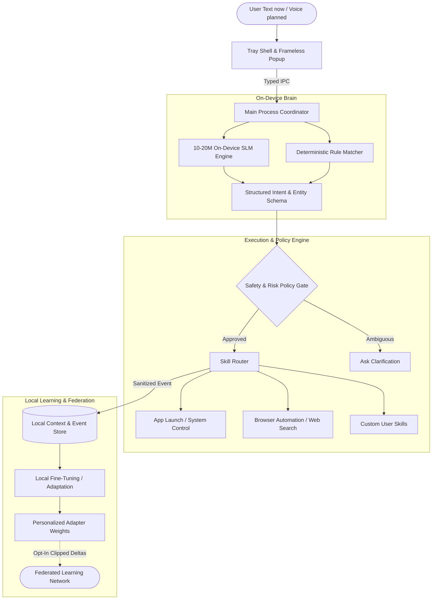

# Ve — High-Level Architecture Overview

## 1. System Vision & Paradigm

Ve's target architecture is a three-tier, local-first system. Networked federation is optional future work; the current implementation does not meet all of these target properties:

1. **Native Desktop Shell & UI Layer** (Electron + React) — unobtrusive system tray presence with instant global hotkey access.
2. **On-Device SLM & Orchestration Brain** (10–20M parameter model + Deterministic Rules) — sub-100ms intent understanding and parameter extraction without cloud latency or privacy risks.
3. **Execution & Automation Engine** (OS System Bridges + Browser Automation) — sandboxed, policy-governed execution of desktop actions with local learning loops.

---

## 2. Core Architectural Components

### A. Presentation Layer (Desktop Shell)
- **Framework**: Electron (Node.js Main + React 19 Renderer).
- **Security Boundary**: Context-isolated Preload bridge with zero raw Node.js API leakage to the UI.
- **User Experience**: The user-positioned floating launcher is Ve's primary visible entry point and opens a compact Chat / Voice / Hide-to-tray menu. Hide moves Ve to the tray without quitting; tray click or global shortcut restores the orb. The frameless chat panel opens near whichever surface launched it.

### B. Language Understanding (10–20M SLM Subsystem)
- **Role**: Parse unstructured user utterances into strict machine-executable JSON schemas (Intents + Entities).
- **Execution Target**: CPU-optimized inference (via ONNX Runtime or embedded micro-engine) consuming $<150\text{ MB}$ RAM with sub-100ms latency.
- **Dual-Path Strategy**: High-confidence regex/prefix rules handle instant common commands; the SLM handles natural language nuance, variations, and composite instructions.

### C. Execution Engine & Skill Router
- **Modularity**: Skills are isolated modules declaring explicit input schemas, risk ratings, and execution hooks.
- **Gatekeeping**: Model outputs are proposals, never raw shell strings. Execution is blocked unless validated against strict schemas.
- **Dynamic App Discovery**: Resolve installed applications through platform-specific OS catalogs at runtime; do not hardcode every installed app in the intent parser. App launch capability does not imply permission to automate that app internally.
- **Scoped File Broker**: File search runs only in user-approved roots or locations selected through the native picker. Resolve candidates and open the chosen file through OS associations; never expose unrestricted filesystem APIs to the model or renderer.
- **Least Privilege**: Main-process policy authorizes each capability and validates IPC. Sensitive transfers show the exact file/recipient/destination and require a short-lived, one-use approval. No generic shell, admin, credential, or arbitrary path-read capability is exposed.
- **Execution Drivers**:
  - Native OS process/protocol handlers for application and URL dispatch.
  - Headless/controlled browser automation (Playwright/CDP) for multi-step web interactions.
  - Native system APIs for volume, display, and window management.

No desktop assistant can guarantee that a compromised host is “foolproof.” Ve should minimize the extra authority it adds, keep each capability narrow, and make sensitive actions explicit so compromise is harder to turn into broad file access, data exfiltration, or destructive execution.

### D. Local Personalization & Federated Learning
- **Local-First Default (Target)**: User history and habits remain on-device. Do not describe the current database as encrypted unless encryption is implemented and verified. Any future network call must be explicit and documented.
- **Continuous Personalization**: The local model adapts to individual phrasing and temporal habits (e.g., app sequences by time of day).
- **Federated Loop**: Opt-in devices train locally and upload only noise-injected, norm-clipped gradient/weight deltas to a federated aggregator to continuously improve the base SLM.

---

## 3. Detailed System Design Reference

These system design documents are target designs and working proposals. They are not implementation claims; check the roadmap and current code before relying on a proposed safeguard or performance target. For technical specifications, see the **System Design Directory**:

- **[System Design Directory](./system-design/)**
  - **High-Level Design (HLD)**:
    - [HLD: System Overview](./system-design/HLD/01-system-overview.md) — Proposed topology, component interactions, and state machines.
    - [HLD: SLM Brain Subsystem](./system-design/HLD/02-slm-subsystem.md) — Model options and inference-runtime proposal.
    - [HLD: Execution Engine & Skills](./system-design/HLD/03-execution-engine.md) — Proposed skill isolation, permission tiers, and OS bridge.
    - [HLD: Federated Learning Topology](./system-design/HLD/04-federated-learning-topology.md) — Future network architecture proposal; not implemented.
  - **Low-Level Design (LLD)**:
    - [01: IPC Contracts](./system-design/01-ipc-contract.md) — Proposed interfaces across Electron boundaries.
    - [02: Intent Parser Schema](./system-design/02-intent-parser-schema.md) — Proposed AST, command schemas, and validators.
    - [03: Local Data Store](./system-design/03-local-store-schema.md) — Proposed persistence schema and privacy filtering.
    - [04: SLM Runtime & Inference Engine](./system-design/04-slm-runtime.md) — Runtime proposal and unvalidated budgets.
    - [05: Federated Aggregation Client](./system-design/05-federated-client.md) — Protocol sketch; current prototype does not implement secure aggregation or DP.
