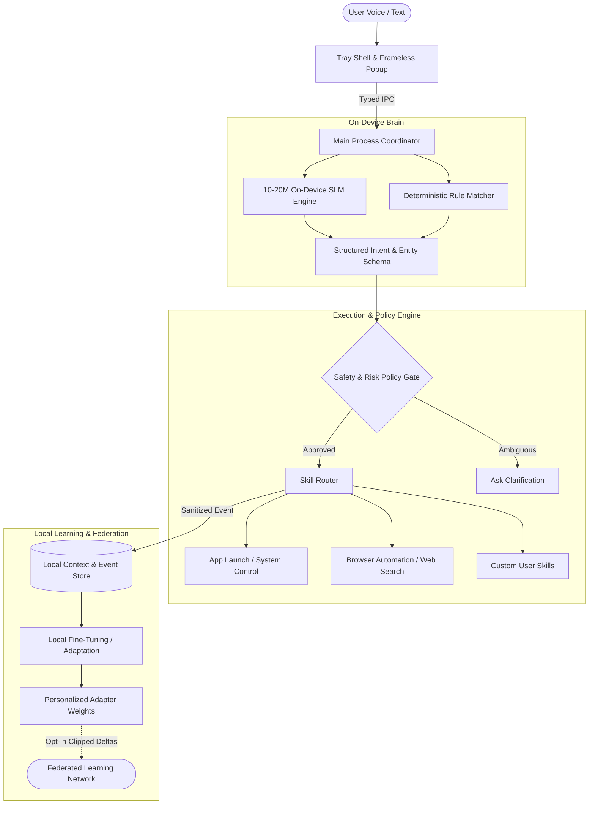

# Ve — High-Level Architecture Overview

## 1. System Vision & Paradigm

Ve is designed around a three-tier architecture that runs entirely on-device:

1. **Native Desktop Shell & UI Layer** (Electron + React) — unobtrusive system tray presence with instant global hotkey access.
2. **On-Device SLM & Orchestration Brain** (10–20M parameter model + Deterministic Rules) — sub-100ms intent understanding and parameter extraction without cloud latency or privacy risks.
3. **Execution & Automation Engine** (OS System Bridges + Browser Automation) — sandboxed, policy-governed execution of desktop actions with local learning loops.

---

## 2. Core Architectural Components

### A. Presentation Layer (Desktop Shell)
- **Framework**: Electron (Node.js Main + React 19 Renderer).
- **Security Boundary**: Context-isolated Preload bridge with zero raw Node.js API leakage to the UI.
- **User Experience**: Fixed-size frameless popup anchored next to the system tray, summoned via global shortcut (`Ctrl+Shift+Space`) or tray icon.

### B. Language Understanding (10–20M SLM Subsystem)
- **Role**: Parse unstructured user utterances into strict machine-executable JSON schemas (Intents + Entities).
- **Execution Target**: CPU-optimized inference (via ONNX Runtime or embedded micro-engine) consuming $<150\text{ MB}$ RAM with sub-100ms latency.
- **Dual-Path Strategy**: High-confidence regex/prefix rules handle instant common commands; the SLM handles natural language nuance, variations, and composite instructions.

### C. Execution Engine & Skill Router
- **Modularity**: Skills are isolated modules declaring explicit input schemas, risk ratings, and execution hooks.
- **Gatekeeping**: Model outputs are proposals, never raw shell strings. Execution is blocked unless validated against strict schemas.
- **Execution Drivers**:
  - Native OS process/protocol handlers for application and URL dispatch.
  - Headless/controlled browser automation (Playwright/CDP) for multi-step web interactions.
  - Native system APIs for volume, display, and window management.

### D. Local Personalization & Federated Learning
- **Zero-Cloud Default**: User history, transcripts, and habits remain strictly inside local encrypted app data.
- **Continuous Personalization**: The local model adapts to individual phrasing and temporal habits (e.g., app sequences by time of day).
- **Federated Loop**: Opt-in devices train locally and upload only noise-injected, norm-clipped gradient/weight deltas to a federated aggregator to continuously improve the base SLM.

---

## 3. Detailed System Design Reference

For in-depth technical specifications, data contracts, and implementation architectures, refer to the **System Design Directory**:

- **[System Design Directory](file:///home/vedvn/ve/docs/system-design/)**
  - **High-Level Design (HLD)**:
    - [HLD: System Overview](file:///home/vedvn/ve/docs/system-design/HLD/01-system-overview.md) — Topology, component interactions, and state machines.
    - [HLD: SLM Brain Subsystem](file:///home/vedvn/ve/docs/system-design/HLD/02-slm-subsystem.md) — 10–20M model architecture, quantization, and inference runtime.
    - [HLD: Execution Engine & Skills](file:///home/vedvn/ve/docs/system-design/HLD/03-execution-engine.md) — Skill isolation, permission tiers, and OS bridge.
    - [HLD: Federated Learning Topology](file:///home/vedvn/ve/docs/system-design/HLD/04-federated-learning-topology.md) — Network architecture, secure aggregation, and privacy.
  - **Low-Level Design (LLD)**:
    - [01: IPC Contracts](file:///home/vedvn/ve/docs/system-design/01-ipc-contract.md) — Typed interfaces across Electron boundaries.
    - [02: Intent Parser Schema](file:///home/vedvn/ve/docs/system-design/02-intent-parser-schema.md) — AST structures, command schemas, and validator specs.
    - [03: Local Data Store](file:///home/vedvn/ve/docs/system-design/03-local-store-schema.md) — Schemas for SQLite/JSON persistence and privacy filtering.
    - [04: SLM Runtime & Inference Engine](file:///home/vedvn/ve/docs/system-design/04-slm-runtime.md) — Memory budgets, C++/Node bindings, and weights packaging.
    - [05: Federated Aggregation Client](file:///home/vedvn/ve/docs/system-design/05-federated-client.md) — Weight diffing, FedAvg calculations, and DP clipping algorithms.
