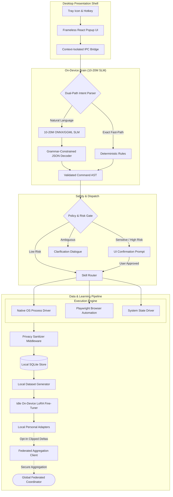
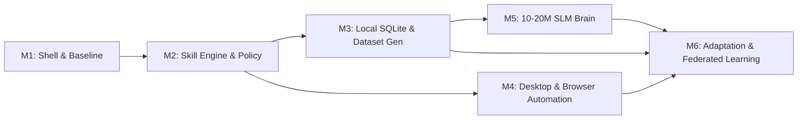

# Ve — Development Roadmap

**An on-device desktop assistant powered by a 10–20M parameter SLM that executes real actions and personalizes locally via federated learning.**

---

## 1. Vision & Architecture Summary

Ve brings intelligent, proactive desktop automation directly to the user's machine without sacrificing privacy or relying on centralized cloud LLMs. The platform is architected around five interconnected pillars:

1. **10–20M Parameter On-Device SLM Brain**: A lightweight Transformer model (INT8/INT4 quantized) running locally on CPU in $<100\text{ms}$ with $<150\text{MB}$ RAM, using grammar-constrained decoding to output strict, schema-compliant JSON command ASTs.
2. **Structured Local Data Storage (SQLite)**: A local-only embedded relational database (`better-sqlite3`) that records privacy-sanitized user behavior, contacts, and state to power on-device training dataset generation.
3. **Modular Skill Engine & Policy Gate**: Decoupled, schema-validated execution modules governed by a multi-tier safety gate that prevents arbitrary shell execution and mandates explicit confirmation for high-risk actions.
4. **Desktop Automation (OS + Browser)**: Fast, non-shell OS process execution combined with Playwright-driven browser automation for complex multi-step web workflows.
5. **Local Adaptation & Federated Learning Loop**: Continuous local LoRA/adapter weight fine-tuning on behavioral datasets, coupled with opt-in, differentially-private federated weight aggregation (FedAvg) to improve base models collaboratively without exposing raw user data.

---

## 2. Dependency-Ordered Milestones

---

### Milestone 1: Hardened Desktop Shell & Deterministic Baseline
**Objective**: Solidify the system tray shell, hotkey handling, frameless React window lifecycle, and secure IPC bridge with a deterministic baseline parser.

- [x] **Frameless Tray Shell**: Electron tray integration positioning the popup adjacent to the OS taskbar/menu bar.
- [x] **React 19 Chat UI**: Fast, responsive chat bubble feed with autogrowing text input and command history navigation.
- [x] **Context-Isolated IPC Bridge**: Zero direct Node.js API exposure in the renderer (`contextBridge.exposeInMainWorld`).
- [ ] **Global Shortcut Lifecycle**: Global summon/hide toggle (`Ctrl+Shift+Space` or `Cmd+Shift+Space`) with reliable focus restoration to previously active desktop applications.
- [ ] **Sub-50ms Popup Latency**: Zero-flash popup rendering, window caching, and instant blur-dismissal behavior.
- [ ] **Deterministic Command Fast-Path**: High-precision prefix/regex parser executing verified exact commands (`open chrome`, `search <query>`) in $<5\text{ms}$.

#### Acceptance Criteria
1. Global hotkey toggles popup visibility and transfers keyboard focus immediately without OS window flicker.
2. Clicking outside popup cleanly dismisses the window without process crashes or memory leaks.
3. Zero Electron security warnings in development; `contextIsolation: true`, `nodeIntegration: false`.
4. Exact-match commands produce instant feedback in the UI without cloud network calls.

---

### Milestone 2: Modular Skill Engine & Policy Gate
**Objective**: Build a typed, extensible skill execution architecture governed by a strict parameter validator and a risk-based confirmation gate.

- [ ] **Unified `BaseSkill` Interface**: Standardized TypeScript contracts for skill registration, metadata, argument schema, and execution lifecycle.
- [ ] **Zod Schema Validation**: Strictly typed parameter parsing for every skill. Model and user inputs are validated against JSON schemas before execution.
- [ ] **No Raw Shell Strings**: Complete prohibition of unbounded `exec` string concatenation; all process execution is parameterized through strict non-shell spawner APIs (`execFile`).
- [ ] **Risk Classification & Confirmation Gate**:
  - `Tier 0 (Read / Query)`: Safe information retrieval; executed immediately.
  - `Tier 1 (Safe Action)`: Launching known applications, navigating to standard URLs; executed immediately with audit toast.
  - `Tier 2 (Sensitive / Mutating)`: Modifying system settings, sending external communications; requires single-click UI confirmation.
  - `Tier 3 (Destructive)`: File deletion, process termination, credential access; requires explicit confirmation modal with action preview.
- [ ] **Core Skills**:
  - `openApp`: OS-native application launch with binary lookup and fuzzy name resolution.
  - `openUrl`: Validated URL launch in user's default browser.
  - `webSearch`: Configurable multi-provider search query dispatch.

#### Acceptance Criteria
1. All model outputs are treated as untrusted proposals; invalid schema parameters are rejected with actionable user-facing errors.
2. Actions marked `Tier 2` or `Tier 3` cannot execute without explicit confirmation from the renderer UI.
3. Unit test coverage verifies schema rejection on malicious or malformed parameters (e.g. command injection tokens).
4. Registering a new skill requires only defining its schema, risk tier, and executor without altering core dispatch logic.

---

### Milestone 3: Structured Local Data Storage & Dataset Generation (SQLite)
**Objective**: Transition from volatile JSON files to an encrypted, high-performance embedded SQLite database that persists history safely and compiles training datasets for SLM fine-tuning.

- [ ] **Embedded SQLite Engine**: Integration of `better-sqlite3` with WAL mode enabled, operating safely in the Electron main process data directory.
- [ ] **Relational Schemas**:
  - `preferences`: User settings, model configuration, and telemetry/learning opt-in flags.
  - `contacts`: User-defined aliases, phone numbers, and entity mappings.
  - `memories`: User notes and explicit persistent facts.
  - `behavior_events`: Timestamped, sanitized logs of executed actions, context features, and outcomes.
  - `local_model_state`: Serialized LoRA adapter tensors, layer shapes, and version hashes.
- [ ] **PrivacySanitizer Pipeline**:
  - Strips query strings, paths, and fragments from URLs (retaining only domain).
  - Redacts raw search query strings and communication message bodies.
  - Blocks storage of credentials, tokens, and password field values.
- [ ] **Training Dataset Generator**:
  - Automated transformation of `behavior_events` into prompt-completion pairs formatted for intent classification and next-action prediction fine-tuning.
  - Extraction of temporal features (time band, day of week, previous action sequence) paired with verified action targets.
- [ ] **User Data Governance UI**:
  - Single-click database viewer in settings.
  - Full JSON data export.
  - Single-click zero-fill purge of all behavioral history.

#### Acceptance Criteria
1. SQLite operations complete in $<10\text{ms}$ on typical queries without blocking Electron UI event loops.
2. Automated test suite validates that zero credentials, message contents, or private search queries leak into `behavior_events`.
3. Dataset generator produces syntactically valid JSONL datasets compatible with fine-tuning pipelines.
4. User clicking "Purge History" executes immediate database deletion verified by disk inspection.

---

### Milestone 4: Desktop Automation & Browser Integration
**Objective**: Enable rich, multi-step desktop and web workflows via native OS hooks and sandboxed Playwright automation.

- [ ] **Native OS Automation Driver**:
  - Multi-platform app resolver (Windows Start Menu/App Paths, macOS `/Applications`, Linux `.desktop` entries).
  - System controls bridge: volume adjustment, media key dispatch, display brightness, and window tiling.
- [ ] **Playwright Browser Automation Driver**:
  - Headless and headed automation engine managing isolated browser sessions.
  - Complex automation workflows: targeted media search (YouTube, Netflix), content lookup, and form navigation.
  - Isolated automation profile preventing unauthorized access to primary personal cookies unless explicitly permitted.
- [ ] **Live Execution Stepper & Cancellation**:
  - Real-time step progress indicator rendered in the popup UI during multi-step automation.
  - Instant user cancellation (`Esc` or "Stop" button) aborting Playwright actions and releasing OS handles.

#### Acceptance Criteria
1. Application launcher reliably locates installed applications without requiring manual file path configuration.
2. Browser automation performs multi-step searches and navigation reliably across network jitter and page load delays.
3. User cancellation terminates automation within 200ms without leaving orphan browser processes.
4. All automation runs with explicit timeouts preventing hung background tasks.

---

### Milestone 5: 10–20M Parameter On-Device SLM Brain Subsystem
**Objective**: Deploy a compact, CPU-optimized 10–20M parameter language model on-device to parse freeform natural language into structured skill schemas with zero cloud reliance.

- [ ] **Micro-Architecture Selection & Model Distillation**:
  - 10M–25M parameter Transformer (compact Encoder-Decoder or Micro-Decoder e.g., SmolLM/TinyBERT/custom distilled seq2seq).
  - Quantized to INT8 or INT4 format for $<25\text{MB}$ disk size and $<150\text{MB}$ active memory footprint.
- [ ] **On-Device Inference Engine**:
  - Embedded `onnxruntime-node` or GGML/`llama.cpp` bindings leveraging CPU vectorization (AVX2, AVX-512, ARM NEON).
  - Sub-100ms P95 latency for intent extraction on standard commodity laptop CPUs.
- [ ] **Grammar-Constrained Decoding**:
  - BNF / JSON schema-guided token masking during decoding to guarantee 100% syntactically valid command output matching registered skill schemas.
  - Zero output hallucinations or unparsable text blobs.
- [ ] **Dual-Path Intent Routing & Ambiguity Resolution**:
  - Intent confidence score calculation:
    - Confidence $\ge 0.85$: Direct dispatch to Policy Gate.
    - $0.50 \le \text{Confidence} < 0.85$: Interactive clarification prompt in chat.
    - Confidence $< 0.50$: Graceful fallback with suggested command syntax.

#### Acceptance Criteria
1. Cold start inference initialization completes in $<500\text{ms}$; warm inference latency stays under 100ms on CPU.
2. Active runtime memory consumption remains below 150MB.
3. Grammar constraint ensures zero malformed JSON syntax errors across a 1,000-utterance test benchmark.
4. Low-confidence queries trigger clarification dialogues instead of erroneous executions.

---

### Milestone 6: On-Device Personalization & Federated Learning Loop
**Objective**: Personalize the assistant to individual user workflows locally, and enable an opt-in federated learning loop that trains collective intelligence without transmitting raw data.

- [ ] **Local Adaptation (LoRA / Adapter Heads)**:
  - Frozen base model weights with a lightweight, trainable adapter layer (~200K parameters).
  - Background fine-tuning on local `behavior_events` executed strictly during device idle states and when connected to AC power.
  - Adapts to user-specific phrasing, aliases, and routine task patterns.
- [ ] **Contextual Next-Action Predictor**:
  - Suggestion engine combining temporal context (time of day, previous action) with personalized adapter logits.
  - Strict confidence gating ($>0.90$) for proactive suggestions.
  - Single-click or hotkey acceptance / dismissal with feedback loop recording.
- [ ] **Federated Aggregation Client**:
  - Round-based protocol client: downloads candidate global model, computes local weight updates.
  - Weight update clipping (L2 norm) and Differential Privacy (DP) Gaussian noise addition.
  - Secure Aggregation payload generation containing encrypted weight shares without device identifiers.
- [ ] **Coordinator & Evaluation Harness**:
  - Reference server implementation aggregating updates using FedAvg across simulated multi-client cohorts.
  - Model verification suite evaluating candidate aggregated models against non-sensitive benchmarks before sign-off.

#### Acceptance Criteria
1. On-device fine-tuning runs in background worker thread consuming $<10\%$ CPU without interrupting UI responsiveness.
2. Proactive suggestions achieve $>80\%$ user acceptance rate with $<5\%$ dismissals under high-confidence gating.
3. Network traffic inspection confirms zero raw text, queries, or user identifiers leave the client during federated rounds.
4. Simulated federated learning benchmarks demonstrate convergence and utility improvements over isolated cold-start models.

---

## 3. Immediate Next Steps & Priority Queue

1. **Complete Milestone 1 Shell Hardening**: Wire global shortcut registration and refine popup window focus restoration.
2. **Implement Milestone 2 BaseSkill & Schema Router**: Port existing skills (`openApp`, `openUrl`, `webSearch`) into the typed `BaseSkill` registry with Zod validation.
3. **Establish Milestone 3 SQLite Persistence**: Set up `better-sqlite3` and implement `PrivacySanitizer` middleware for event logging.
4. **SLM Prototype**: Benchmark 14M–20M distilled models in ONNX Runtime for intent extraction latency and accuracy.
