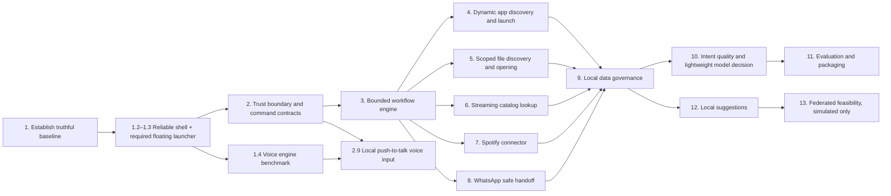

# Ve — Delivery Roadmap

This roadmap is the execution source of truth. The product/system requirement set is in [requirements.md](requirements.md); each step below implements a slice of those requirements and is scoped so a coding agent can implement, verify, mark, and hand it off. Do steps in order within a phase; start a later phase only after its listed dependencies are complete.

## Product direction

Ve is a lightweight, local-first desktop assistant that interprets a goal, discovers relevant installed apps, user-scoped files, or online sources, and performs the task through registered capabilities. App discovery and launch must be dynamic, not a hardcoded app-name list. Internal app tasks use explicit integrations. The product should minimize cloud AI calls and resource use; online lookups must be disclosed. Ve is not an unrestricted machine-control agent: access is scoped, sensitive actions require approval, and the model cannot emit arbitrary shell commands or paths. Local personalization is later work; federated learning is an optional research direction with no current privacy guarantee.

## Working agreements for roadmap steps

- A step is complete only when its acceptance checks pass, docs reflect the shipped behavior, and the step's code is committed or otherwise reviewed in the normal project workflow.
- Preserve working behavior and public contracts unless the step explicitly changes them. Keep changes scoped to one step.
- Do not claim a privacy, security, latency, accuracy, or platform guarantee without a reproducible check and stated test conditions.
- When a dependency or product decision blocks implementation, record the evidence and a narrow decision request in the step; do not silently invent an infrastructure or model choice.
- Update this file's checkbox and status notes as work advances. “Prototype” means useful local code exists but its production safeguards or evaluation are incomplete.

## Current state (2026-10-24)

The repository contains an Electron/React tray shell, text command UI, ONNX embedding-based intent prototype, deterministic fallback parser, a skill registry/router with app/browser/WhatsApp modules, SQLite persistence, a local action predictor, and a local FedAvg aggregation prototype. The intent model is not yet a demonstrated 10–20M generative SLM; the skill system does not yet provide the full policy/confirmation gate described in design docs; browser workflows and voice are incomplete; federated code is not connected to a network and provides neither secure aggregation nor differential privacy. See [README](../README.md) and [product definition](product.md) for the current inventory.

## Dependency map

## Phase 1 — Make the current prototype trustworthy

### Step 1.1 — Establish an accurate behavior and security baseline

- [x] Complete — audited command paths, stored fields, external handoffs, and known platform/security limits in [implementation baseline](implementation-baseline.md).
**Goal:** Know what the checked-in app actually does and make its current behavior safe to describe.

**Work:** Inventory the app's commands, IPC handlers, skill validation, storage fields, network calls, platform behavior, and model artifact. Correct any immediate mismatch between runtime behavior and product claims. Document known limitations and the supported development OS.

**Audit notes (2026-10-24):** Normal command execution previously persisted command text and action to SQLite and updated the local predictor without opt-in. Automatic writes and suggestions are now disabled; older records are not removed. The full table/field inventory, supported command paths, external handoffs, and known limitations are in [implementation-baseline.md](implementation-baseline.md). The development environment is WSL2 on x86_64 with Windows host integration; a release support matrix is still undeclared. IPC sender/payload validation remains for Steps 2.1–2.2.

**Done when:** README's current-status section matches the code; every command shown as supported has a traced path from UI to handler to executor; all external network calls and stored fields are listed; no design-only capability is described as shipped.

### Step 1.2 — Make the basic tray interaction dependable

- [x] Complete — startup popup and taskbar presence verified by the user; tray icon visibility is not required in this environment.
**Depends on:** 1.1.
**Goal:** A user can summon, use, and dismiss Ve repeatedly without losing focus or getting a broken popup.

**Work:** Finish hotkey registration/lifecycle, popup show/hide and focus behavior, outside-click dismissal, startup/shutdown cleanup, and clear action success/failure feedback. Keep voice marked unavailable until it works end to end.

**Implementation status (2026-10-24):** Single-instance ownership, tray/shortcut restoration, popup recreation after close, delayed display until renderer readiness, and taskbar presence while the popup is open are implemented. Starting Ve opens its popup because launching the app is an explicit user action and some desktops do not expose tray icons. The user verified that `npm start` opens Ve and keeps it in the taskbar; tray icon visibility is not required in this environment. Switching focus to an app launched from Ve no longer dismisses Ve when the pointer remains inside its popup; clicking outside still dismisses it to the tray. Automated suites cover popup focus policy and IPC sender validation.

**Done when:** Manual acceptance notes cover repeated hotkey toggles, tray click, focus return, outside dismissal, app restart, and unavailable voice behavior on the declared target OS; no duplicate shortcuts/listeners remain after reload.

### Step 1.3 — Add the required floating assistant launcher

- [ ] Awaiting user desktop verification — the latest code adds center dragging and a taskbar "Show orb" action, but the user has not yet confirmed center smoothness or that the menu stays attached after repeated interactions.
**Depends on:** 1.2.
**Goal:** Make the movable orb Ve's primary visible entry point while retaining the system tray for the user's explicit hide/minimize state and recovery.

**Implementation status (2026-10-24):** Started after Step 1.2 was accepted and committed. The orb is required and will launch with Ve; it must remain independently hideable to the tray.

**Progress:** Added a transparent always-on-top orb window, compact Chat / disabled Voice / Hide menu, anchored menu placement, keyboard repositioning, screen-edge clamping, local position persistence, and monitor-change recovery. Linux hides the orb to a taskbar-visible Ve window so the app remains reachable when no tray icon is exposed; its chat header now has a "Show orb" action that hides the chat window and restores the launcher. Other platforms continue hiding to the tray. The app, tray, and orb use a shared minimalist Ve identity generated by `scripts/generate-icons.cjs`. WSL detection reserves the host taskbar area even when WSL environment variables are missing. Outer-ring movement uses Electron's native draggable region; the center remains clickable and supports click-versus-drag using a threshold and animation-frame-coalesced one-way IPC. Center movement now avoids duplicate menu repositioning and persistence work per frame, then saves once at drag completion; all menu following goes through the orb's native move event. First launch uses a deterministic visible bottom-right position, while a saved user position is restored on later launches. Unit checks cover movement policy, trusted one-way IPC, native-drag wiring, taskbar return action, menu anchoring, screen bounds, WSL taskbar inset, and focus handling. The user still needs to verify center movement smoothness and that repeated orb/menu interactions keep the buttons attached. Multi-display and non-Linux desktop behavior remain unverified.

**Work:** Show the floating orb as part of normal Ve startup/running state. The orb opens a compact, labeled menu for Chat, Voice, and Hide/Minimize-to-tray; keep Voice disabled and explained until voice is implemented. Use native window dragging around the outer circle and thresholded, coalesced pointer movement from the center so the center still supports both clicks and drags. Keep the menu anchored to the orb. Persist position per display, clamp it into visible work areas, and recover placement when monitors or DPI/resolution change. Hiding moves Ve to the tray without exiting; on Linux without a usable tray, keep Ve available in its taskbar window and provide a visible action to restore the orb. Add keyboard move/reposition access and follow focus, contrast, and reduced-motion preferences.

**Done when:** Manual checks cover orb visible on normal startup, center click versus center drag and outer-ring drag, smooth movement with the menu following, edge clamping, multiple displays, display removal/reconnect, scaling changes, restart/position restore, hide-to-tray/taskbar and restore through the visible action, keyboard-only use, no accidental focus stealing, and disabled mic behavior; the tray or taskbar fallback remains available while the orb is hidden.

### Step 1.4 — Select the local voice-recognition runtime

- [ ] In progress — English and Windows x64 + Linux x64 are confirmed as the initial voice benchmark scope. [Voice runtime evaluation](voice-runtime-evaluation.md) records the official-source shortlist, fixed prompt set, and scoring plan. No runtime is selected until consented command samples, target-hardware measurements, and native packaging checks on both targets are complete. Research is proceeding while Step 1.3's desktop acceptance remains open at the user's direction.
**Depends on:** 1.1.
**Goal:** Choose a speech recognizer that fits Ve's privacy, language, and low-resource targets before enabling the launcher microphone.

**Work:** Treat sherpa-onnx Node bindings with its streaming English Zipformer 20M int8 model as the first candidate. Compare it with Whisper tiny.en and suitable Vosk language models on short, consented Ve commands. Measure command success and false actions as well as transcription accuracy, latency, CPU/RAM, disk size, and Electron native packaging on the declared target OS. Decide initial language support and verify model licenses. Voice is push-to-talk, local-only, no stored audio, and transcription lands in the editable composer; the user explicitly sends it.

**Done when:** A decision record selects an engine/model using recorded results from representative speech and target hardware, or records why no candidate meets the threshold and what alternative is needed. The choice must preserve offline operation and must not directly execute a transcript.

## Phase 2 — Build the trust boundary and task capabilities

### Step 2.1 — Define Ve's threat model and capability permissions

- [ ] Mark complete when the acceptance checks below pass.
**Depends on:** 1.1.
**Goal:** Limit what a compromised renderer, malicious model output, hostile webpage, or compromised host can make Ve do.

**Work:** Document assets and threats: local files, contacts, messages, app sessions, and user identity. Define capability-based permissions, IPC sender validation, main-process enforcement, consent boundaries, data-flow limits, and confirmation requirements. Explicitly prohibit arbitrary shell/PowerShell, admin elevation, broad filesystem crawling, unprompted credential access, and model-selected paths. Treat web content, app metadata, and model output as untrusted input. Note that a compromised host cannot be made foolproof; minimize Ve's additional access and blast radius.

**Implementation status (2026-10-24):** As an early security slice, every renderer IPC handler now rejects requests unless they originate from Ve's exact local main frame; command and personal-data payloads have bounded string validation. The renderer is sandboxed, remote navigation is blocked, and popup creation requests are denied. Automated tests cover untrusted frames/URLs, malformed payloads, unsafe navigation schemes, and shell-like app names. The full threat model, capability permission policy, confirmation rules, and security review in this step are still outstanding.

**Done when:** A threat model maps each capability to least-privilege access and abuse cases; every privileged operation has a main-process policy; no renderer/model input can directly invoke a generic command or filesystem API; the security limits are documented without claiming perfect protection.

### Step 2.2 — Define command, result, and confirmation contracts

- [ ] Mark complete when the acceptance checks below pass.
**Depends on:** 2.1.
**Goal:** Parser, IPC, router, UI, and skills agree on typed actions and policy-controlled outcomes.

**Work:** Reconcile the IPC and intent-schema docs with real TypeScript contracts. Define versioned capability IDs, validated params, progress/cancellation, clarification, and structured results. Enforce risk in the main process. Create expiring, one-use confirmations that display exact resource, recipient, and side effect; never trust risk supplied by renderer or model.

**Done when:** Every capability uses one validated contract across the boundary; malformed and unknown fields fail closed; forged, expired, replayed, rejected, and canceled confirmations never execute; all outcomes are reported clearly.

### Step 2.3 — Build the bounded task workflow engine

- [ ] Mark complete when the acceptance checks below pass.
**Depends on:** 2.2.
**Goal:** Turn a validated user goal into visible, cancellable, and verifiable steps without letting the model run an open-ended agent loop.

**Work:** Implement a workflow state machine/DAG over registered capabilities. Define preconditions, output contracts, timeout/cancellation, bounded retries, idempotency for side effects, progress events, partial failure, and recovery. The model may propose a task plan, but deterministic orchestration validates it and advances only through approved steps. Re-check outcomes after each action; never automatically replay a send/share operation.

**Done when:** A multi-step local demo can plan, execute, report each step, cancel, and recover from a failed step; repeated or malformed model plans cannot exceed registered capabilities, step/time budgets, or user authorization; side effects are not repeated after uncertain outcomes.

### Step 2.4 — Discover and launch installed apps dynamically

- [ ] Mark complete when the acceptance checks below pass.
**Depends on:** 2.2 and 2.3.
**Goal:** Users can launch apps installed on their system without Ve hardcoding each app name in its intent logic.

**Work:** Implement an OS-specific installed-app catalog using OS metadata and a safe launcher. Normalize aliases/search at runtime, display ambiguous matches, validate resolved executable identity and catalog provenance, and launch without shell interpolation. Treat user-writable or unknown app entries as untrusted and require deliberate user selection/confirmation. Keep platform discovery adapters separate from the shared command planner. Do not imply that generic launch grants permission to automate an app internally.

**Done when:** Acceptance notes demonstrate discovery and launch of apps not listed in Ve source; ambiguous or spoofed entries do not execute silently; missing apps and unsupported OS behavior return clear choices/errors; no arbitrary path or command string can be launched from model output.

### Step 2.5 — Find and open user-scoped files

- [ ] Mark complete when the acceptance checks below pass.
**Depends on:** 2.1–2.3.
**Goal:** Ve can find and open a requested image or document without acquiring unrestricted access to the filesystem.

**Work:** Define user-approved roots (initially standard folders such as Downloads/Documents or a native file picker). Search filenames/metadata first; make content indexing a separate explicit choice. Return candidate paths for user selection when ambiguous, then open through the OS association API. Protect against traversal, symlinks escaping approved roots, stale paths, and unsafe file types. Keep file bytes out of logs and model prompts unless the user explicitly requests an operation that needs them.

**Done when:** It finds a named PDF/image only inside approved scope, lets the user choose among matches, opens the selected file, and refuses access outside scope; revoke/disable controls exist; logs contain no document contents or sensitive path data.

### Step 2.6 — Add online streaming availability lookup

- [ ] Mark complete when the acceptance checks below pass.
**Depends on:** 2.2–2.4.
**Goal:** Find where a requested show or movie is currently available, then open a verified provider destination when possible.

**Work:** Separate local intent parsing from optional online lookup. Disclose when a query leaves the device; evaluate TMDB/JustWatch for country-specific provider availability, attribution, commercial terms, freshness, and missing deep links. Show the provider/title/source and fall back to a provider search page when an exact destination is unavailable. Keep the provider behind an interface so it can be replaced. Never scrape secrets or reuse browser credentials.

**Done when:** Cases cover title not found, ambiguous titles, multiple providers, market mismatch, unavailable service, missing deep link, stale data, and network failure; UI shows provider/source and lookup date; attribution/license requirements are met; core parsing and app launch still work offline; no false claim of universal app control.

### Step 2.7 — Add the Spotify connector feasibility slice

- [ ] Mark complete when the acceptance checks below pass.
**Depends on:** 2.2–2.4.
**Goal:** Let a user request Spotify music without making Spotify API access a hidden requirement.

**Work:** First implement/verify dynamic app discovery and opening a Spotify URI/search destination. Separately prototype the Web API path with OAuth Authorization Code + PKCE and minimal scopes. Confirm the user's authorization, Premium eligibility, active playback device, current Development Mode requirements and quota, product terms, and Spotify's prohibition on using its content for model training. Do not copy catalog/content into learning data. Provide a no-API/manual fallback if authorization or account eligibility is absent.

**Done when:** App/URI fallback works without Spotify API credentials; API playback is attempted only with valid user consent, eligible account/device, supported scope and current developer access; expired tokens, no active device, 403/429 and network failures give clear outcomes; Ve does not use Spotify data for model training or imply an API path is available to every user.

### Step 2.8 — Prepare WhatsApp file sharing with a safe user handoff

- [ ] Mark complete when the acceptance checks below pass.
**Depends on:** 2.2, 2.3, 2.5.
**Goal:** Help the user prepare a file share without claiming unsupported automation of a personal WhatsApp account.

**Work:** Resolve the contact and exact file using approved local data. WhatsApp click-to-chat can open a conversation and prefill text but does not attach a local file; WhatsApp Desktop supports the user manually selecting and sending an attachment. Provide a clear handoff that opens the official chat where supported and guides the user to attach/review/send. Do not automate browser internals, reverse engineer WhatsApp, or send on a personal account unless an officially supported and terms-compliant interface is verified. Treat WhatsApp Business Platform separately: it is for business/customer messaging, requires business onboarding, policy-compliant templates/windows and may incur fees; do not use it as a workaround for personal messaging.

**Done when:** UI presents exact contact and file before handing off; opening the chat does not send; the user performs the final attach/send action in WhatsApp; cancellation leaves no outgoing message; logs omit file contents and message body; automatic personal-account sending remains disabled absent a verified official integration.

### Step 2.9 — Add local push-to-talk voice input

- [ ] Mark complete when the acceptance checks below pass.
**Depends on:** 1.4, 2.1, and 2.2.
**Goal:** Let users speak commands without adding a cloud speech dependency or bypassing command policy.

**Work:** Implement the selected local ASR behind a speech-recognizer interface, with mic capture isolated from intent/model code. Request OS permission on demand, show recording/listening/error states, stop on release/cancel/timeout, and never persist raw audio. Load ASR outside the renderer's privileged boundary and package native dependencies for the supported OS. Fill the existing composer with the transcript for editing; the user must press Send. Route accepted text through the exact typed command path and policy checks. Keep the microphone disabled on model/permission failure and allow text-only use.

**Done when:** On the declared OS and hardware, checks cover permission grant/denial/revocation, recording/cancel/timeout, transcript correction, offline operation, unavailable model/mic, and typed/voice parity. No audio is written or sent; a transcript cannot invoke a capability without the user's Send action; measured CPU/RAM/latency and supported languages are documented.

## Phase 3 — Make local data controls real

### Step 3.1 — Specify stored data and retention

- [ ] Mark complete when the acceptance checks below pass.
**Depends on:** 1.1.
**Goal:** Align the storage implementation and privacy docs around the actual data lifecycle.

**Work:** Reconcile `docs/system-design/03-local-store-schema.md` with SQLite tables and sanitizer behavior. Decide which command text is retained for local training, how it is protected, event retention, export semantics, purge semantics, and whether database encryption is actually in scope. Do not call SQLite encrypted unless encryption is implemented and verified.

**Done when:** A field-by-field data inventory identifies purpose, sensitivity, retention, and deletion behavior; the UI wording matches it; docs distinguish local storage from any future network transfer.

### Step 3.2 — Finish user data controls

- [ ] Mark complete when the acceptance checks below pass.
**Depends on:** 3.1.
**Goal:** Users can inspect, export, pause, and erase the data used by personalization.

**Work:** Implement and expose the agreed export and erase controls, learning opt-in/off switch, bounded retention, and migration recovery. Ensure clearing behavior resets derived local model state but preserves separately managed contacts/notes as documented.

**Done when:** UI flows and manual checks demonstrate export contents, opt-out behavior, retention pruning, migration safety, and complete deletion of the selected data; no hidden learning continues after opt-out.

## Phase 4 — Improve understanding with evidence

### Step 4.1 — Define a command benchmark and confidence behavior

- [ ] Mark complete when the acceptance checks below pass.
**Depends on:** 2.2–2.8 and 3.1.
**Goal:** Measure whether Ve understands supported requests and selects the right local resource/integration before investing in a larger model.

**Work:** Create a versioned, privacy-safe set of synthetic/consented requests for app launch, scoped file search, online content lookup, integrations, confirmation and cancellation, paraphrases, ambiguity, unsupported requests, and adversarial inputs. Compare deterministic rules and the current ONNX embedding prototype. Calibrate confidence against errors; clarification must win over unsafe guessing.

**Done when:** Results report per-intent accuracy, slot accuracy, ambiguity handling, false-execution cases, latency, and hardware/runtime conditions; benchmark can be rerun locally; unsupported commands never route to an unrelated skill.

### Step 4.2 — Decide the intent model based on benchmark results

- [ ] Mark complete when the acceptance checks below pass.
**Depends on:** 4.1.
**Goal:** Choose the smallest dependable approach for Ve's bounded command vocabulary.

**Work:** Compare deterministic rules, compact classifiers/slot taggers, task-tuned small models, and larger local candidates against the same end-to-end benchmark. Use local models for language ambiguity and typed plan proposals; use OS catalogs, search/providers, deterministic orchestration, and focused connectors for facts and actions. Do not assume a 10–20M model can replace a frontier model or serve as the sole planner. Do not add cloud AI calls to the default flow. Record model/artifact provenance, license, task success and wrong-action rates, memory, cold/warm latency, CPU/battery cost, and behavior on low-spec target hardware.

**Done when:** A decision record assigns each task to rules, local model, retrieval/provider, or integration; selects a model only where it improves end-to-end success within the agreed resource budget; defines clarification/escalation behavior; and records release thresholds. If a request needs unsupported reasoning or integration, Ve clarifies or reports the limit instead of guessing. Any future optional remote model path is a separate opt-in decision with data/cost disclosure.

## Phase 5 — Deliver personalization without overclaiming

### Step 5.1 — Validate local prediction utility

- [ ] Mark complete when the acceptance checks below pass.
**Depends on:** 3.2, 4.1.
**Goal:** Determine whether the local action predictor makes useful suggestions for one user.

**Work:** Define offline evaluation and minimum-data rules; separate predictive confidence from softmax scores; record suggestion accept/dismiss feedback with consent; ensure only eligible low-risk actions can be suggested.

**Done when:** Evaluation reports top-k usefulness, calibration, acceptance, dismissal, and no-data behavior; suggestion UI is opt-in, dismissible, and never auto-executes; delete/opt-out controls cover events and model state.

### Step 5.2 — Explore federated learning in simulation only

- [ ] Mark complete when the acceptance checks below pass.
**Depends on:** 5.1.
**Goal:** Test whether cross-device aggregation adds measurable value before designing a service.

**Work:** Use synthetic clients and the narrow next-action model. Specify threat model, secure aggregation protocol, cohort behavior, differential privacy accountant, poisoning defenses, artifact signing, and update compatibility. Correct the existing prototype/docs so clipping, noise, and secure aggregation claims match the implementation. Do not use real user data or transmit updates in this step.

**Done when:** Reproducible simulation compares local-only and federated utility; privacy parameters and limitations are documented; protocol review identifies implementation gaps. Networked federation remains a separate decision and roadmap step requiring a concrete service/security design.

## Phase 6 — Release readiness

### Step 6.1 — Stabilize supported platform and packaging

- [ ] Mark complete when the acceptance checks below pass.
**Depends on:** 2.3–2.8, 3.2, 4.2.
**Goal:** Make the supported build installable and recoverable on its declared OS.

**Work:** Set target OS scope; package native dependencies/model assets; define upgrades, rollback, logs, and crash recovery; document permissions, offline behavior, and model downloads if any.

**Done when:** A clean-machine install/uninstall/upgrade walkthrough succeeds on the supported OS; app works offline for core commands; artifact sizes and startup/resource use are measured; known limitations are in release docs.

## Deferred / explicitly out of current scope

Voice input stays disabled until Steps 1.4 and 2.9 pass. Broad system controls, arbitrary browser workflows, community skills, startup suggestions, cloud intent parsing with real user commands, and production federated infrastructure stay deferred until the relevant earlier phases pass. Messaging is a high-impact integration and should remain narrowly scoped with explicit confirmation and platform/terms review.
