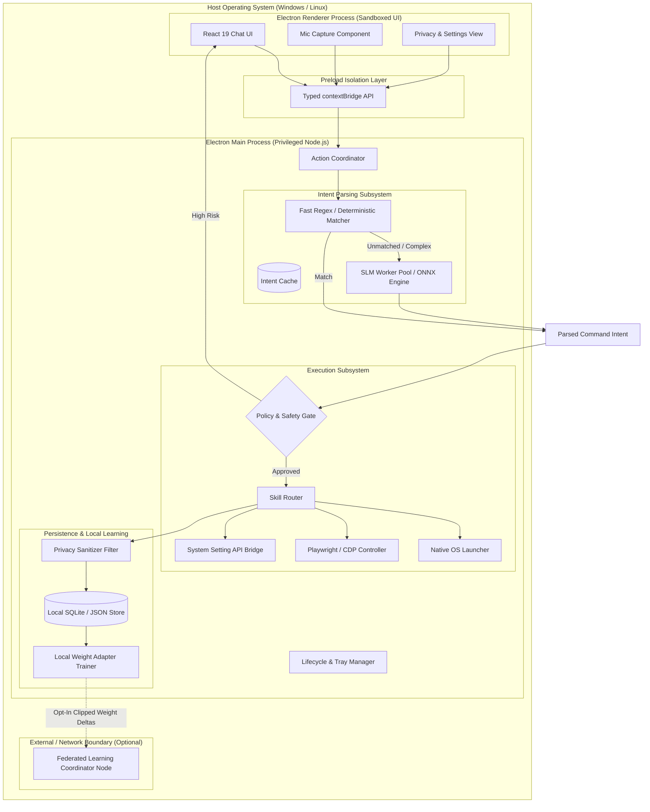

# HLD 01: System Overview & Component Topology

## 1. System Goals & Core Constraints

| Constraint | Architectural Target |
|---|---|
| **Latency** | End-to-end execution $<150\text{ms}$ for local deterministic skills; $<300\text{ms}$ when invoking SLM intent parsing. |
| **Footprint** | Idle RAM $<120\text{MB}$; peak execution $<250\text{MB}$ including the SLM runtime. CPU $<1\%$ when idle. |
| **Data Privacy** | 100% of raw user text, app paths, credentials, and browsing activity remain strictly within the local host boundaries. |
| **Availability** | Core desktop automation must function completely offline without internet connectivity or external API keys. |

---

## 2. Global Component Topology

---

## 3. Inter-Process Communication & Data Flow

### Request Lifecycle Sequence
1. **Trigger**: Current prototype accepts typed text with `Enter`; local voice input is planned and must follow the same command path after it is implemented.
2. **IPC Dispatch**: Renderer dispatches an immutable message payload via `window.veAPI.executeCommand(payload)` over `ipcRenderer.invoke`.
3. **Intent Resolution**:
   - The Main Process passes the input through the deterministic rule engine (Fast Path).
   - If no direct rule matches with high confidence ($\ge 0.98$), the input is passed to the **10–20M SLM Runtime** (Smart Path).
4. **Policy & Permission Validation**:
   - The structured command (`{ skill, params, riskLevel }`) is checked against the safety policy.
   - Low-risk actions (e.g., launch app, search web) execute immediately.
   - High-risk actions (e.g., delete files, write scripts, send messages) trigger an interactive user confirmation modal in the UI.
5. **Skill Execution**:
   - The Skill Router dispatches parameters to the specialized executor.
   - The executor interacts with native OS APIs or browser automation drivers.
6. **Telemetry & Sanitization**:
   - Execution status (success/failure, execution time, timestamp band) is extracted.
   - Sensitive arguments (passwords, raw search queries, private URLs) are scrubbed.
   - Scrubbed event tokens are appended to the local store for on-device personalization.

---

## 4. Failure Modes & Graceful Degradation

| Failure Scenario | Fallback Behavior |
|---|---|
| **SLM Inference Timeout ($>500\text{ms}$)** | Fallback to deterministic regex matching; if unmatched, prompt user for clarification. |
| **Model Weight File Missing or Corrupted** | Application loads in "Deterministic-Only Mode"; prompts user to re-download base SLM model. |
| **Automation Driver Crash (e.g. Browser disconnect)** | Isolated failure returned to UI; main Electron app remains stable and responsive. |
| **Corrupted Local DB** | DB resets to fresh state; previous corrupted file backed up to `.bak` locally without crash. |
