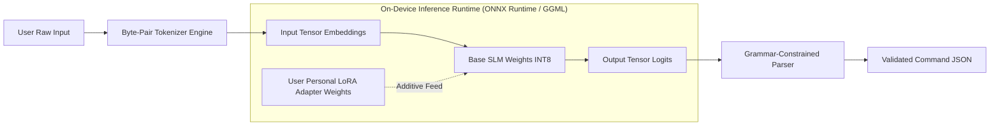
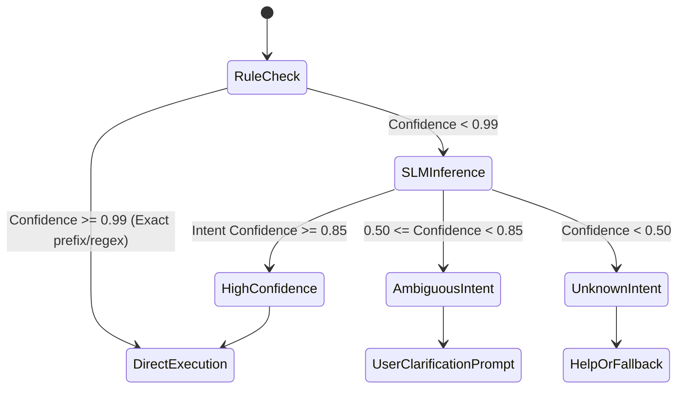

# HLD 02: 10–20M Parameter SLM Brain Subsystem

## 1. Role & Requirements

The on-device SLM serves as the central parser and natural language reasoning layer for Ve. It translates fuzzy human intent into strict, validated JSON command schemas.

### Primary Objectives
- **Parameter Count**: $10\text{M} - 25\text{M}$ parameters.
- **Quantization**: INT8 or INT4 quantization yielding a runtime binary size $<25\text{MB}$.
- **Inference Latency**: $\le 100\text{ms}$ on modern multi-core x86/ARM CPUs without requiring discrete GPU acceleration.
- **Zero Cloud Leakage**: Inference runs 100% locally in-process or via an isolated local sidecar process.

---

## 2. Model Architecture Candidates

To hit the 10–20M parameter envelope with high intent-extraction fidelity, the architecture is constrained to compact Transformer topologies:

| Architecture | Param Size | Primary Strength | Weakness |
|---|---|---|---|
| **Distilled Encoder (MiniLM / MobileBERT / TinyBERT)** | ~14M–22M | Exceptional sequence classification and token tagging (slot filling). Extremely fast ($<30\text{ms}$). | Cannot generate arbitrary freeform text; output is restricted to intent logits + slot spans. |
| **Micro-Decoder (SmolLM-15M / TinyLLaMA-Micro)** | ~15M–28M | Generates structured JSON natively; handles conversational nuances and zero-shot rephrasing well. | Slower than encoder-only; autoregressive token generation requires strict decoding constraints to avoid malformed JSON. |
| **Encoder-Decoder (T5-Small distilled / micro-BART)** | ~18M–25M | Highly targeted seq2seq mapping (text $\rightarrow$ canonical command string). | Higher latency overhead than pure encoder. |

> **Recommended Baseline**: A custom **Encoder-Decoder or Micro-Decoder** architecture fine-tuned specifically for text-to-JSON grammar generation, or a dual-head **Encoder (Intent Classifier + Token Tagging Slot Filler)** for guaranteed zero-hallucination parsing.

---

## 3. Inference Engine Architecture

### Key Components
1. **Tokenizer**: Fast Rust/C++ binding or pure JS BPE tokenizer (e.g. HuggingFace tokenizers compiled to WebAssembly / native Node addon).
2. **Inference Backend**:
   - Primary: `onnxruntime-node` utilizing CPU execution provider (AVX2/AVX-512 and ARM NEON optimizations).
   - Alternative: `llama.cpp` node bindings (`node-llama-cpp`) with INT4/INT8 GGUF quantized models.
3. **Constrained Decoding**:
   - Uses JSON schema BNF grammars during generation to guarantee the model outputs syntactically valid JSON matching registered skill interfaces.
   - Prevents hallucinations and ensures that intent keys always map to valid skills.

---

## 4. Personalization & Adapter Layer (On-Device Training)

To adapt the model to the user's personal shorthand, contacts, and custom app names without catastrophic forgetting:

- **LoRA / Adapter Heads**:
  - The base 10–20M model weights remain **frozen**.
  - A tiny rank-4 or rank-8 Low-Rank Adaptation (LoRA) layer ($\sim 200\text{K}$ trainable parameters) is updated on-device.
  - Updates occur asynchronously in background worker threads when the device is idle or plugged in.
- **Context Injection**:
  - Personal aliases (e.g., "browser" $\rightarrow$ "Vivaldi", "work" $\rightarrow$ "Jira") are passed as structured context tokens into the prompt prefix rather than requiring model weight modification for simple aliases.

---

## 5. Intent vs. Fallback Routing Logic

