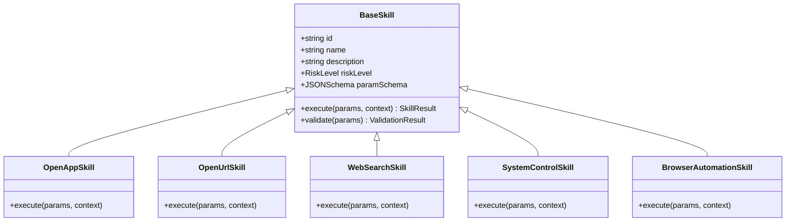
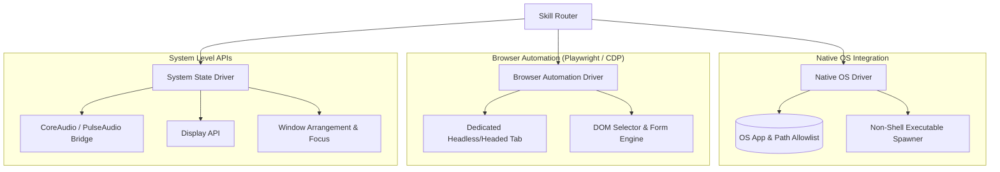

# HLD 03: Desktop Execution Engine & Skill Architecture

## 1. Execution Principles

The execution engine is the "hands" of the Jarvis architecture. While the SLM acts as the interpreter, the Execution Engine is strictly deterministic and governed by security boundaries:

1. **No Raw Shell Access**: Natural language models are prohibited from directly emitting arbitrary bash, PowerShell, or command prompt strings.
2. **Schema-Bound Invocation**: Skills accept strictly validated parameters (e.g., verified URLs, allow-listed application identifiers, or validated coordinates).
3. **Auditability & Reversibility**: All executions produce a structured trace; actions carrying side effects require explicit policy approval.

---

## 2. Skill Registry & Isolation Topology



### Skill Lifecycle
1. **Registration**: Skills register their intent identifiers, parameter JSON schemas, and risk tiers at application startup.
2. **Validation**: Incoming commands from the Intent Parser pass through schema validators before reaching the skill executor.
3. **Context Injection**: Ambient state (current active window, timestamp, clipboard state) is injected into the execution context.
4. **Execution Sandbox**: Privileged actions run in worker threads or dedicated child processes with bounded execution timeouts (typically 5 seconds max).

---

## 3. Automation Drivers & Integration Boundaries

### Driver Categories



1. **Native OS Driver**:
   - Launches applications using safe, non-shell APIs (e.g., `child_process.execFile` or platform-native APIs like `ShellExecuteEx` on Windows, rather than `exec` with string concatenation).
   - Resolves application names through an OS index (Start Menu shortcuts, `.desktop` files, PATH binary lookup).
2. **Browser Automation Driver**:
   - Built on top of Playwright or direct Chrome DevTools Protocol (CDP) sessions.
   - Used for multi-step browser workflows (e.g., logging in, navigating web applications, extracting data).
   - Runs in isolated automation browser profiles so personal session cookies are separated unless explicitly configured.
3. **System State Driver**:
   - Manages OS audio volume, media keys (play/pause/skip), screen brightness, and power management actions.

---

## 4. Policy, Risk Classification & Confirmation Gate

Every command is categorized into a defined risk tier before execution:

| Risk Tier | Examples | Execution Behavior |
|---|---|---|
| **Tier 0 (Read-Only / Safe)** | Web search, launch calculator, check system status | Executes instantly without interruption ($<50\text{ms}$). |
| **Tier 1 (Mild Side Effect)** | Open URL, switch active window, adjust volume | Executes instantly; shows unobtrusive status toast in UI. |
| **Tier 2 (External / Communication)** | Send WhatsApp message, post comment, compose email | Displays confirmation modal in popup: requires single-click or `Enter` approval. |
| **Tier 3 (Destructive / High Impact)** | Delete files, terminate system processes, modify OS settings | Displays explicit warning modal with full parameter diff; requires explicit confirmation. |

---

## 5. Execution Result Contract

All skill executions return a standardized contract:

```typescript
export interface SkillResult<T = unknown> {
  success: boolean;
  skillId: string;
  executionTimeMs: number;
  outputSummary: string;
  data?: T;
  error?: {
    code: string;
    message: string;
    suggestedFix?: string;
  };
}
```
