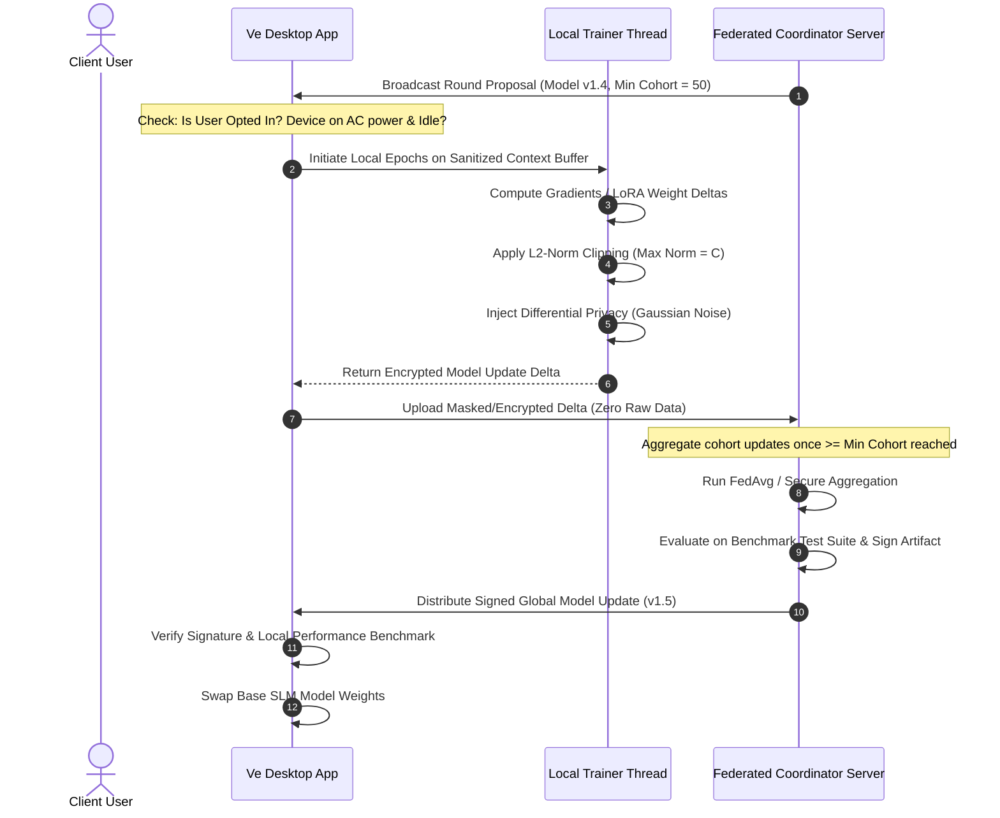
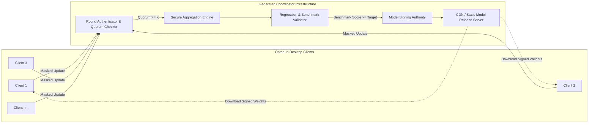

# HLD 04: Federated Learning Topology & Privacy Architecture

## 1. Core Principle

Ve is **local-first**. The assistant does not require federated learning to operate. Federated learning serves exclusively as an opt-in collective intelligence loop: improving base SLM intent understanding and action prediction models across devices **without centralizing user activity, text, or behavior**.

```
Client Machine 1 (Trains locally) ──> [Norm Clip + Noise] ──┐
Client Machine 2 (Trains locally) ──> [Norm Clip + Noise] ──┼──> [Secure Aggregation Server] ──> New Global Base SLM
Client Machine 3 (Trains locally) ──> [Norm Clip + Noise] ──┘
```

---

## 2. Federated Training Architecture



---

## 3. Privacy Guarantees & Safeguards

### What Leaves the Device vs. What Stays

| Artifact | Stays on Device | Sent to Coordinator |
|---|---|---|
| **Raw Utterances & Prompts** | **Yes** (100% Local) | Never |
| **Contact Names & Phone Numbers** | **Yes** (100% Local) | Never |
| **Browsing URLs & Search Queries** | **Yes** (100% Local) | Never |
| **App Paths & Window Titles** | **Yes** (100% Local) | Never |
| **Local Behavioral Timestamps** | **Yes** (100% Local) | Never |
| **Model Weight Deltas ($\Delta W$)** | Filtered & Clipped | **Only Masked/Encrypted Deltas** |

### Mathematical Privacy Protections
1. **$L_2$ Norm Clipping**:
   Before transmission, local weight updates $\Delta W_k$ are clipped by a threshold $S$:
   $$\Delta \bar{W}_k = \Delta W_k \cdot \min\left(1, \frac{S}{\|\Delta W_k\|_2}\right)$$
   This prevents any individual user's update from exerting disproportionate influence or encoding specific raw training examples.
2. **Differential Privacy (DP-FedAvg)**:
   Calibrated Gaussian noise $\mathcal{N}(0, \sigma^2 S^2)$ is added to the aggregated sum to provide mathematically proven $(\epsilon, \delta)$-differential privacy bounds.
3. **Cohort Gating**:
   A round is rejected and aborted unless at least $K \ge 50$ distinct client updates participate in the aggregation round.

---

## 4. Federated Aggregator Topology



---

## 5. Security & Threat Mitigation

| Threat Vector | Mitigation Strategy |
|---|---|
| **Model Poisoning / Sybil Attack** | Update magnitude clipping, robust aggregation (e.g. Coordinate-wise Median / Trimmed Mean instead of naive mean), and strict client rate limits. |
| **Inversion Attack (Reconstructing data from weights)** | Secure multi-party computation / secret sharing during aggregation so the coordinator never sees individual unmasked client weights. |
| **Malicious Global Model Distribution** | All distributed models are cryptographically signed using an asymmetric public-private key pair; clients reject unsigned model blobs. |
| **Resource Drain on Client Laptop** | Local training triggers only when: (1) battery is $>80\%$ or device is plugged in, and (2) CPU has been idle for $>5$ minutes. |
